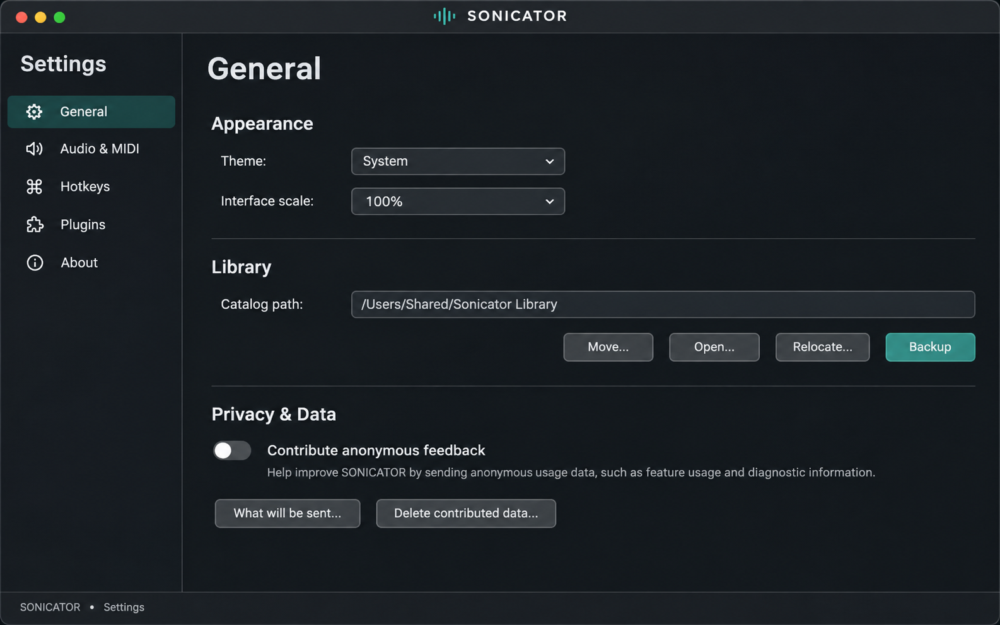

# Settings с боковой навигацией — план и ТЗ

Дата: 2026-11-14. Статус: реализовано в ветке `stage-settings-hotkeys-layout` (приёмка — `docs/SETTINGS_HOTKEYS_LAYOUT_ACCEPTANCE.md`).

## Цель

Перестроить окно Settings: **слева узкая вертикальная колонка** с разделами `General`, `Audio & MIDI`, `Hotkeys`, `Plugins`, `About`; **справа основная область** с содержимым выбранного раздела. Это трактовка описания, в котором обе области были названы «справа». Окно не должно быть одной длинной страницей, требующей прокрутки через все настройки.

Выбор раздела меняет содержимое правой области без открытия нового окна. Настройки, которые уже применяются сразу, сохраняют это поведение. Опасные действия и операции с файлами сохраняют свои подтверждения.

## Эскиз

Эскиз показывает расположение навигации и элементов, а не утверждённый текст интерфейса. В частности, подпись под `Contribute anonymous feedback` на изображении условная и неточная: фактическое описание должно соответствовать текущей функции передачи подтверждённых типов, тегов, темпа, тональности и акустических чисел для обучения модели. Данные об использовании приложения или диагностике эта настройка не отправляет.

## Разделы

| Раздел | Содержимое |
|---|---|
| General | Theme, interface scale, language; каталог: текущая база, Move/Open/Relocate, Backup; согласие на передачу обучающих данных, предпросмотр и удаление отправленного. Внутри раздела допустимы группы `Appearance`, `Library`, `Privacy & Data`. |
| Audio & MIDI | Выбор аудиоустройства и MIDI-настроек. Существующий отдельный диалог Audio/MIDI перевести в содержимое этого раздела или встроить его компонент без второго модального окна; функциональность сохранить. |
| Hotkeys | Поиск команд, текущие сочетания, назначить/сбросить/разрешить конфликт. Связанный документ: `2026-11-14-customizable-shortcuts-design.md`. |
| Plugins | Список пользовательских компонентов, установка из архива или URL репозитория, включение/выключение, обновление, удаление, ошибки. Название вкладки `Plugins` в UI допустимо; в технической документации это `user components`, отдельно от VST3/AU Sonicator. Связанный документ: `2026-11-14-user-plugins-design.md`. |
| About | Версия, автор, лицензии и credits, модель и дата обучения, ссылки поддержки; существующие Report a bug / Request a feature / Format support / Ask or discuss разместить здесь в группе `Help & Feedback`. |

Пока Hotkeys и Plugins не реализованы, разделы должны показывать ясное состояние `Coming later` с кратким описанием, а не пустую панель или неработающие кнопки. Если перестройка Settings будет выполняться одновременно с этими фичами, разделы сразу наполняются их интерфейсами.

## Макет и взаимодействие

- Слева постоянная колонка примерно 160–200 px при обычном масштабе, справа область с заголовком текущего раздела и прокручиваемым содержимым. Точные размеры выбрать по реальным контролам и масштабам 100–150%; важны читаемость и отсутствие обрезания текста.
- Активный пункт явно выделен цветом/фоном и доступен с клавиатуры. Tab проходит по пунктам и контролам; стрелки перемещают выделение в списке разделов, Enter/Space открывает раздел. Фокус после переключения предсказуемо переходит к заголовку или первому контролу.
- Состояния отдельных разделов (выбранный пункт, прокрутка, несохранённый ввод в Hotkeys/Plugins) не должны теряться при простом переключении. При закрытии/повторном открытии разумно возвращать последний выбранный раздел, кроме недоступного в данном режиме.
- Длинные пути к базе и диагностические сообщения переносятся или сокращаются визуально с полным текстом в tooltip; кнопки остаются видимыми при стандартной ширине окна.
- Тема System/Dark/Light и масштаб интерфейса применяются ко всей навигации и содержимому. На небольшом экране правая часть прокручивается вертикально, окно остаётся в пределах рабочей области.
- Состояния `disabled`, ошибка и выполняемое действие видны рядом с соответствующим контролом. Например, операции каталога заблокированы во время индексации и объясняют причину.

## Особенность VST3/AU-режима

Нынешний `SettingsPanel::setPluginMode` скрывает управление каталогом и устройствами, так как хост DAW владеет аудио и каталогом. Новая навигация должна строиться из доступных разделов/групп, а не показывать пустые страницы. В VST3/AU-режиме `Audio & MIDI` и пользовательские `Plugins` скрыты, пока нет отдельной подтверждённой реализации для хоста; General показывает только применимые настройки, About остаётся доступным. Закрытие окна продолжает работать в обоих режимах.

## Архитектурный план

Сейчас `ui/settings/SettingsPanel.cpp` размещает все элементы в одном длинном `resized()` и содержит обработчики настройки базы, consent, Report и About. Разделить на контейнер навигации и отдельные компоненты страниц, не дублируя состояние `AppSettings` и callbacks. `SonicatorUI` управляет страницами; модели настроек и операции остаются у существующих владельцев. Данные о последнем разделе хранить в настройках только после решения о нужной персистентности. Ссылки из других мест приложения должны уметь открыть конкретный раздел, например `Settings → Hotkeys` или `Settings → Plugins`.

## Этапы

1. Инвентаризировать существующие контролы и callback, включая диагностику, backup, consent, Audio/MIDI и VST3/AU-режим.
2. Создать оболочку окна с левой навигацией и правой областью, адаптивными размерами, темой и клавиатурным фокусом.
3. Перенести существующие настройки в General, Audio & MIDI, About без смены смысла и сохранения.
4. Добавить страницы Hotkeys и Plugins как точки интеграции с их отдельными ТЗ; не реализованные функции честно обозначить.
5. Проверить светлую/тёмную тему, масштабы, маленький экран, длинные пути, работу с клавиатуры и режим DAW-плагина.

## Критерии приёмки

- Все пять разделов видны в самостоятельном приложении; переключение меняет только правую область и не открывает новое окно.
- Все существующие настройки и действия доступны из соответствующих разделов и работают как до перестройки, включая Report, backup, consent и Audio/MIDI.
- General не обрезает длинные пути и сообщения; правое содержимое прокручивается, левая навигация остаётся видимой.
- Тема, масштаб, фокус клавиатуры и состояние выбранного раздела работают предсказуемо.
- В VST3/AU-режиме не отображаются недоступные настройки; About и применимые настройки доступны.
- Страницы Hotkeys и Plugins не обещают работающую функцию до её реализации.

Реализация: `ui/settings/SettingsPanel`, `HotkeysPanel`, `ui/shell/PanelLayout`.
